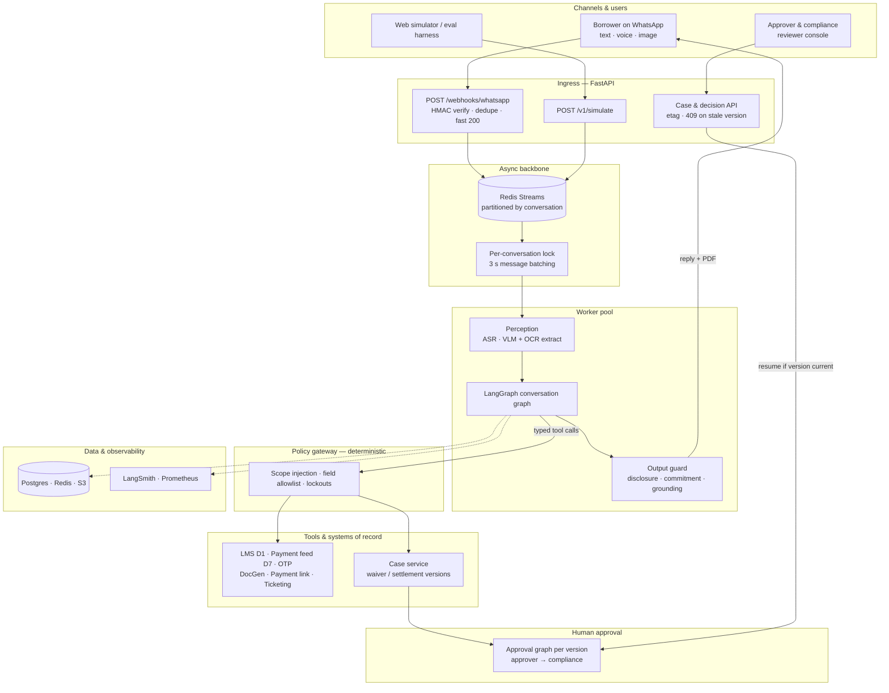
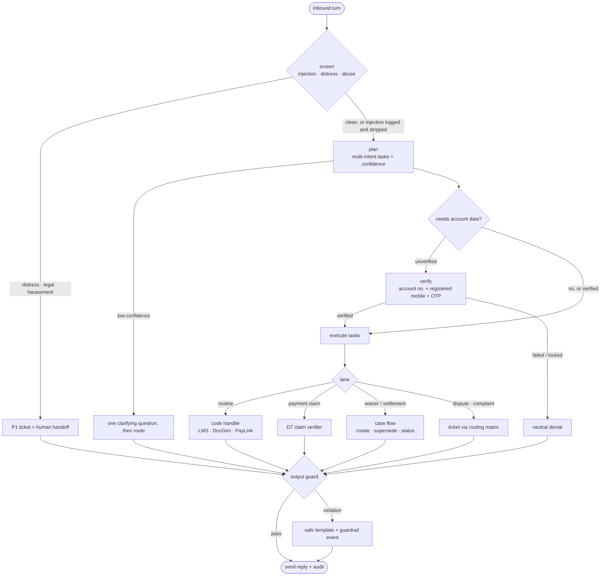

# Inbound WhatsApp Servicing Agent

Agentathon build for the **inbound WhatsApp servicing agent**: resolve routine borrower
requests ("already paid", receipts, statements, foreclosure amounts, dues) within minutes,
and route everything else (disputes, complaints, waivers, settlements) to the right queue
with full context.

| Doc | What's in it |
|---|---|
| [docs/ARCHITECTURE.md](docs/ARCHITECTURE.md) | All eight architecture and flow diagrams (rendered on GitHub), plus a design-vs-code status table |
| [docs/architecture-flows.html](docs/architecture-flows.html) | The same diagrams as a standalone page; download the file and open it in a browser |
| [docs/DESIGN.md](docs/DESIGN.md) | The full design: verification, payments, approvals, synthetic data, eval gates |
| [docs/TEAMS.md](docs/TEAMS.md) | Three-team split, interface freeze, milestones |
| [docs/DECISIONS.md](docs/DECISIONS.md) | Settled decisions, and open ones with their defaults |

## Design in one paragraph

This is one bounded LangGraph state machine, not a multi-agent system. LLMs do
perception (speech-to-text, screenshot extraction), planning across intents and the
wording of replies. Deterministic code owns every decision with consequences:

- **The D7 ledger decides payments.** A claim is accepted only on an exact D7 match, so
  every edited or fake screenshot ends in "not accepted + flagged".
- **The policy gateway enforces verification and account scope.** The model never holds
  unverified data, and it can never ask for another account.
- **Templates, the routing matrix and the case service own waivers and routing.** The
  agent cannot make a commitment, and approvals can never land on a superseded request.

## Architecture

The system has eight layers. Ingress only acknowledges and enqueues. Workers run
perception and the LangGraph conversation graph. Every call that touches account data goes
through the deterministic **policy gateway**, which injects the verified `account_id` and
cuts each result down to the fields that intent may see. Waiver and settlement decisions
come back through a version-checked case API. A decision on an outdated version gets a 409.



Each turn runs through a bounded state machine. The LLM does perception, planning and
tone. Lane selection, handlers and the output guard are code.



[docs/ARCHITECTURE.md](docs/ARCHITECTURE.md) has the six other diagrams:

- end-to-end message sequence
- verification flow
- payment-claim reconciliation
- case states
- the supersession and stale-approval sequence
- the eval and CI loop

These diagrams show the target design. The table at the end of that doc lists what's
built and what isn't.

## Quickstart

```bash
make setup      # venv + install (Python 3.11+)
make data       # synthetic D1/D2/D7 for 10,000 accounts -> data/generated/
make test
make run        # http://localhost:8000/docs
make eval       # scenario conversations through the agent; fails on any zero-tolerance metric
```

Try a turn:

```bash
curl -s localhost:8000/v1/simulate/messages -H 'content-type: application/json' \
  -d '{"sender":"919876543210","text":"what is my foreclosure amount"}' | jq
```

### Real images and voice notes (Sarvam)

Put your key in `.env` (git-ignored), then start the server with real perception:

```bash
echo 'SARVAM_API_KEY=your-key-here' >> .env
make run-sarvam
```

Send a receipt screenshot (the file goes base64-encoded in `media_base64`):

```bash
jq -n --arg b64 "$(base64 -i receipt.png)" \
  '{sender:"919876543210", type:"image", media_base64:$b64, media_filename:"receipt.png"}' \
  | curl -s localhost:8000/v1/simulate/messages -H 'content-type: application/json' -d @- | jq
```

Use `type:"voice"` with a `.ogg` or `.wav` file for voice notes. `.ogg` needs `ffmpeg`.

Every uploaded file is saved to `data/media/YYYY/MM/DD/<message_id>.<ext>`. A `.json` file
next to it records the conversation, size, SHA-256 and what was extracted. The folder is
git-ignored because it holds real borrower data. Change the location with `SA_MEDIA_DIR`.

To test the Sarvam clients alone, without the server:
`.venv/bin/python -m servicing_agent.data.perception.cli receipt receipt.png`

The OTP stub accepts `SA_OTP_STUB_CODE` (default `123456`). To use Claude for planning,
install the `llm` extra, set `SA_PLANNER=llm` and set `ANTHROPIC_API_KEY`. The rules
planner needs no key and is the fallback whenever the LLM call fails.

## Layout and ownership

| Path | Team | What |
|---|---|---|
| `src/servicing_agent/contracts/` | **All (frozen)** | Conversation state, tool signatures, case/decision API, event model |
| `src/servicing_agent/agent/` | **T1** Agent Core & Guardrails | LangGraph turn, verification, policy gateway, planner, handlers, screening, output guard, templates |
| `src/servicing_agent/platform/` | **T2** Platform, Integrations & Human Approval | FastAPI, mock tools, versioned case service, context pack, persistence, conversation store |
| `src/servicing_agent/data/` | **T3** Data, Perception & Evaluation | Synthetic data generators, data store, D7 reconciliation, perception stubs |
| `evals/` | **T3** | Scenario generator, deterministic evaluators, eval runner |
| `config/` | T2/T3 | Routing matrix, per-intent field allow-lists, policy bands |
| `data/generated/` | T3 | Committed synthetic CSVs (seed 42, 10,000 accounts); regenerate with `make data` |
| `evals/results/` | T3 | Latest eval summary, per-conversation results and the 300 labelled dev scenarios |
| `docs/` | All | Architecture diagrams, design, team split, decisions |
| `tests/` | All | Unit and end-to-end tests |

## API

| Method | Path | Purpose |
|---|---|---|
| POST | `/v1/simulate/messages` | One synchronous turn (eval harness and demo) |
| GET/POST | `/webhooks/whatsapp` | BSP handshake and inbound messages |
| GET | `/v1/conversations/{id}` | Transcript, events and tickets |
| GET | `/v1/tickets?queue=` | Routed tickets |
| GET | `/v1/cases/{case_id}` | Case with every version and decision |
| GET | `/v1/cases/{case_id}/versions/{v}/context` | Context pack for approver and compliance |
| POST | `/v1/cases/{case_id}/versions/{v}/decisions` | Approver/compliance decision (409 if superseded or stale) |
| GET | `/healthz` | Health |

## Parked (by decision)

- Screenshot tamper forensics (ELA, EXIF, layout). The D7 match still catches every fake.
- Dunning suppression on verified payment.
