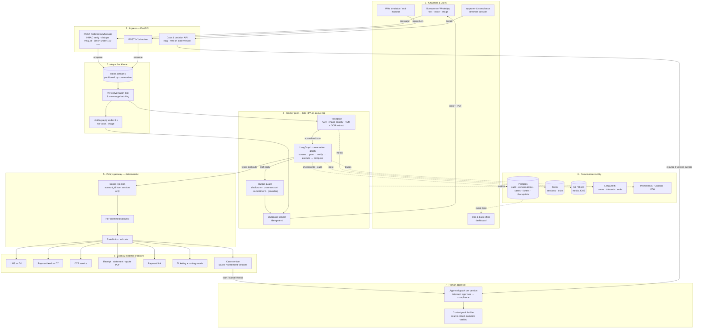
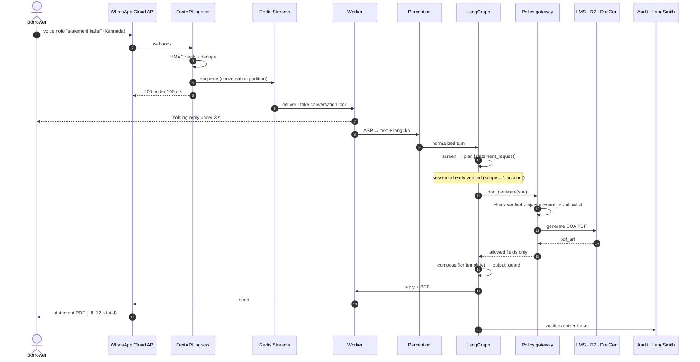
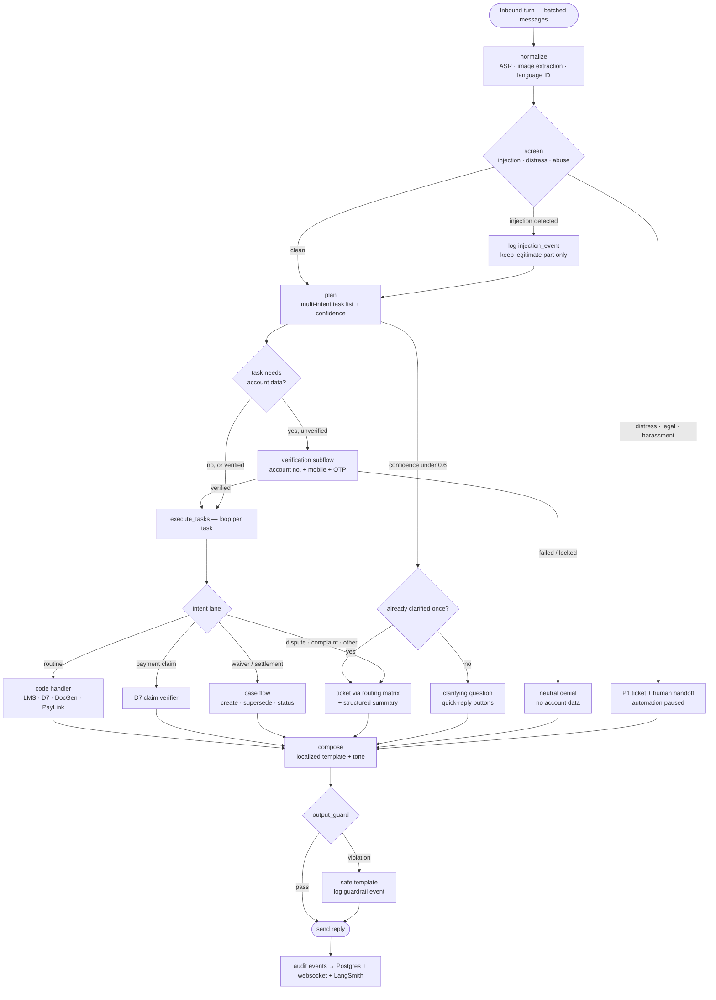
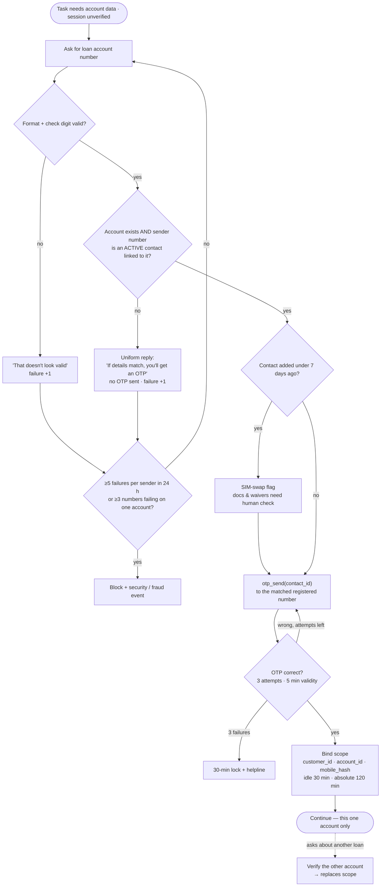
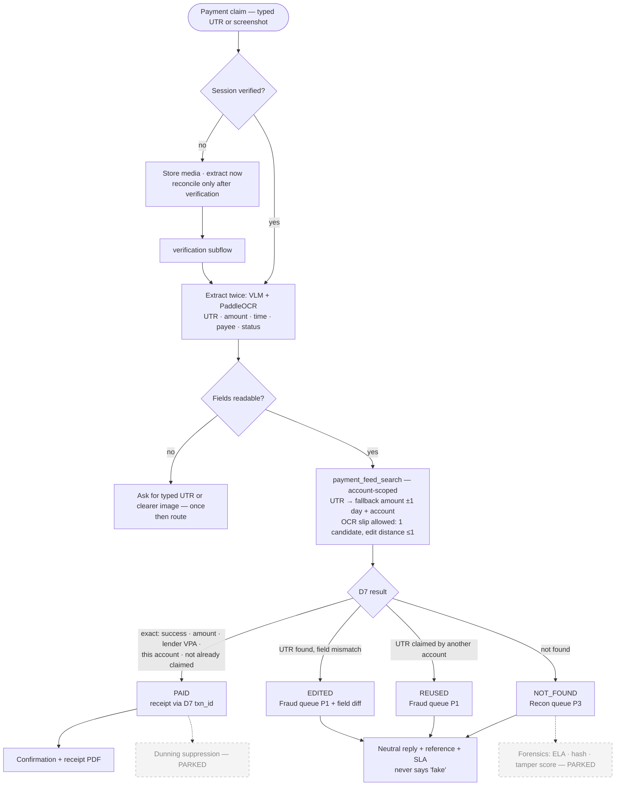
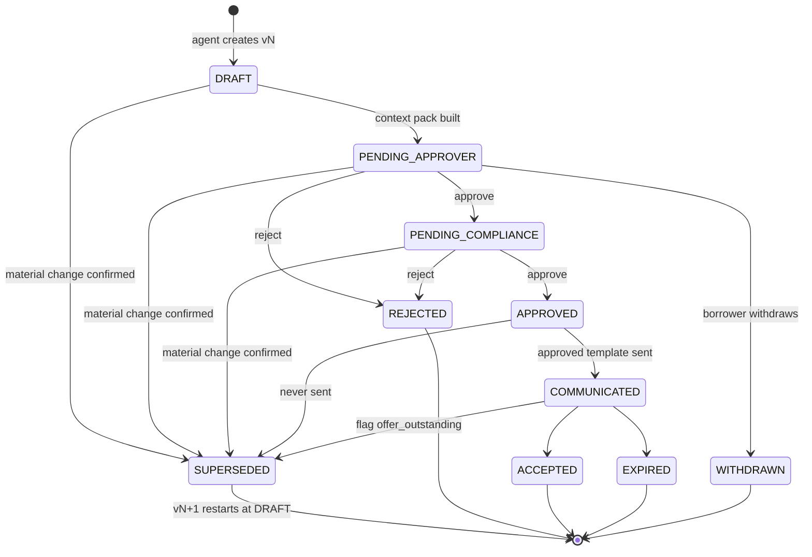
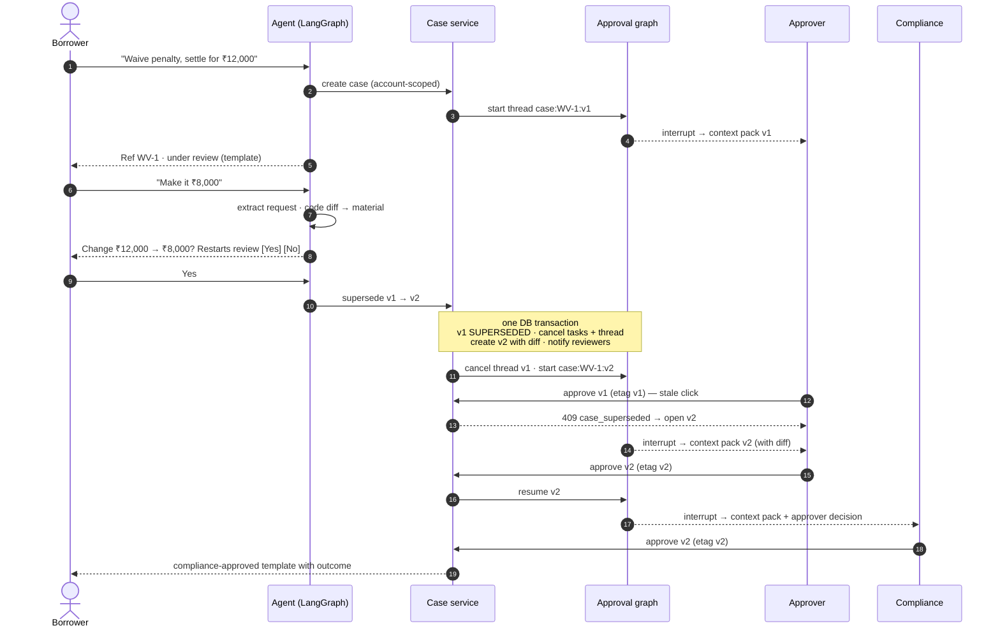
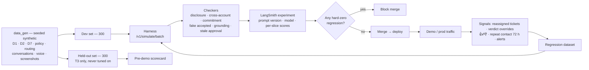

# Architecture and flows

These are the mermaid sources for the eight diagrams on the architecture page
([architecture-flows.html](architecture-flows.html)); GitHub renders them inline. The
diagrams show the **target design** agreed on 19 Nov 2026. Some parts aren't built yet.
[Design vs. current code](#design-vs-current-code) at the end lists every difference.

1. [System architecture](#1-system-architecture)
2. [End-to-end message sequence](#2-end-to-end-message-sequence)
3. [Conversation graph (LangGraph)](#3-conversation-graph-langgraph)
4. [Verification: account number + mobile + OTP](#4-verification-account-number--mobile--otp)
5. [Payment-claim reconciliation](#5-payment-claim-reconciliation)
6. [Waiver / settlement case states](#6-waiver--settlement-case-states)
7. [Supersession and stale-approval guard](#7-supersession-and-stale-approval-guard)
8. [Evaluation and CI loop](#8-evaluation-and-ci-loop)

## 1. System architecture

The system has eight layers. Every call that touches account data goes from the
LangGraph agent through the deterministic policy gateway. The gateway injects the
verified `account_id`, so the model can't reach another account.

- Ingress only acknowledges and enqueues, and workers do the processing. That keeps the
  webhook under 100 ms.
- The per-conversation lock keeps a borrower's messages in order. Messages sent within
  3 s of each other are handled as one turn.
- Voice and image turns get a holding reply within 3 s.
- Waiver and settlement decisions arrive through the case API. They resume an approval
  thread only if that request version is still current.

## 2. End-to-end message sequence

A verified borrower sends a Kannada voice note asking for a statement. The PDF arrives
about 8–12 s later. The time breaks down as roughly 0.1 s ingress, 1–2 s holding reply,
2–4 s speech-to-text, about 1 s planning, under 1 s tools, and 1–2 s compose and guard.
Every account call passes the gateway, and every step writes an audit event.

## 3. Conversation graph (LangGraph)

This is the bounded state machine every turn runs through. The LLM is used only in
normalize, plan and compose. Lane selection, handlers and the output guard are code.

- Distress, legal threats and harassment skip planning and go straight to a human.
- A detected injection is logged, and only the legitimate part of the message is
  handled.
- Low confidence gets one clarifying question. If the borrower is still unclear, the
  conversation is routed to a person.

## 4. Verification: account number + mobile + OTP

The borrower gives a loan account number. The sender's WhatsApp number must be an
active registered contact of that account, and an OTP then confirms it. The reply is the
same whether or not the details match. A session covers one account; asking about
another loan means verifying that one, which replaces the scope.

## 5. Payment-claim reconciliation

A screenshot is something to search with, never proof of payment. Only an exact D7 match
marks a payment as paid. Edited and reused proofs go to the fraud queue, and the
borrower gets a neutral reply. Forensics and dunning suppression are parked (dashed
boxes).

## 6. Waiver / settlement case states

Each request version goes from the approver to compliance. A confirmed material change
moves the current version to `SUPERSEDED` from any non-final state, and v+1 restarts from
`DRAFT`. A material change is a code diff on type, amount, components, plan or reason,
and the borrower must confirm it. Status checks, new evidence and duplicate messages
don't restart the flow.

## 7. Supersession and stale-approval guard

The borrower changes ₹12,000 to ₹8,000. Version 1 is cancelled in one transaction, and
the approver's late click on v1 gets a 409. Version 2 then goes through the full flow
with a diff against v1. Each version runs on its own LangGraph thread
(`case:{id}:v{n}`), paused with `interrupt()` and resumed only through the
version-checked decision API.

## 8. Evaluation and CI loop

Synthetic data feeds a dev set and a held-out set. Code-based checkers block any merge
that breaks a must-be-zero metric:

- disclosure before verification
- cross-account data
- commitments
- fake payments accepted
- numbers not backed by a tool result
- approvals on stale versions

Production signals flow back as regression cases.

## Design vs. current code

The diagrams are the target. This table shows where the code in `src/servicing_agent/`
stands today, so each team can see what's left. ✅ matches, 🟡 partly there or named
differently, ⬜ not built yet.

| Area | Design (diagrams) | Code today | Owner |
|---|---|---|---|
| Ingress | Webhook enqueues to Redis Streams, returns 200 in under 100 ms | ⬜ Webhook and `/v1/simulate/messages` call the agent directly; no HMAC check | T2 |
| Queue, lock, batching | Redis Streams, per-conversation lock, 3 s batching | 🟡 In-process lock in `platform/conversations.py`; no queue or batching | T2 |
| Holding reply | Under 3 s for voice and image | ⬜ | T2 |
| Perception | Speech-to-text, image classification, VLM + OCR | ⬜ Stub: `/simulate` takes pre-extracted `receipt` / `transcript` | T3 |
| Graph nodes | normalize → screen → plan → verify → execute → compose → output_guard | 🟡 No separate normalize/compose nodes; replies come straight from templates in the handlers | T1 |
| Lanes and routing | Routine, payment claim, case flow, ticket | ✅ `agent/handlers.py` | T1 |
| Clarify once, then route | Yes | ✅ | T1 |
| Verification | Account number + active contact + OTP; uniform reply | ✅ `agent/verification.py` | T1 |
| Lockouts | 3 OTP tries; 5 failures per sender in 24 h; 3+ numbers failing on one account | 🟡 First two done; per-account cross-number check missing | T1 |
| SIM-swap flag | Contact added in the last 7 days → human check before docs and waivers | 🟡 Recorded on the `verified` event; not enforced | T1 |
| OTP and session lifetime | OTP valid 5 min; session idle 30 min, absolute 120 min | 🟡 Idle 30 min only | T1/T2 |
| Unverified screenshot | Store and extract now, reconcile after verification | ✅ Claim waits in `pending_tasks` until verified | T1 |
| Payment verdict names | PAID / EDITED / REUSED / NOT_FOUND | 🟡 `MATCHED` / `MISMATCH`, `OTHER_ACCOUNT`, `REPLAY` / `NOT_FOUND`, plus `PENDING` inside the settlement window | T3 |
| Not-found routing | Recon queue P3 | 🟡 `payment_reconciliation` is P2 in `config/routing_matrix.yaml` | T2 |
| Receipt source | Built from the D7 `txn_id` | 🟡 Built from the matched D7 transaction, keyed by UTR | T2 |
| Case states | DRAFT, PENDING_*, APPROVED, COMMUNICATED, ACCEPTED, EXPIRED, WITHDRAWN, SUPERSEDED | 🟡 No DRAFT, ACCEPTED, EXPIRED or WITHDRAWN yet; new versions start at `PENDING_APPROVER` | T2 |
| Supersede in one transaction, 409 on stale etag | Yes | ✅ `platform/cases.py`, tested with concurrent races | T2 |
| Approval graph per version | `case:{id}:v{n}` thread, `interrupt()` approver → compliance | ⬜ Decisions update the DB directly | T2 |
| Context pack | Source-linked, numbers verified | ✅ `platform/context_pack.py` (template-built) | T2 |
| Reviewer console, ops dashboard | Yes | ⬜ | T2 |
| Postgres, Redis, S3, LangSmith, Prometheus | Yes | 🟡 SQLite for cases and audit; everything else not yet wired | T2/T3 |
| Eval harness | `/v1/simulate/batch`, checkers, LangSmith, CI gate | 🟡 `evals/run_eval.py` runs in-process with the same zero-tolerance gates; no batch endpoint, LangSmith or CI yet | T3 |
| Voice and screenshot datasets | Yes | ⬜ Text-only scenarios | T3 |
| Concurrency target | 500 concurrent conversations (the page footer also says 750 users in section 8) | ⬜ Not load-tested | T2 |
