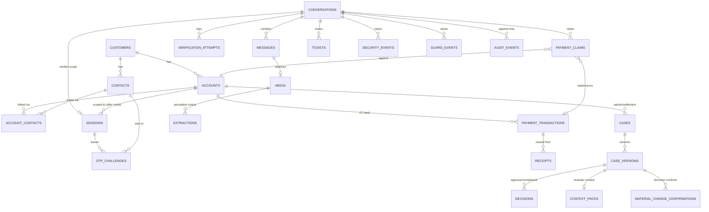

# Data model (ERD)

Entity-relationship model for the inbound servicing agent, reconciled against the
architecture doc (`ARCHITECTURE.md`, `architecture-flows.html`), the settled/open
decisions (`DECISIONS.md`), the frozen contracts (`src/servicing_agent/contracts/`),
and what the code persists today (`platform/db.py`, `platform/conversations.py`,
`data/store.py`). **This is a design artifact — no tables are created from it.** Build
order and ownership are in the per-table notes.

## Storage layers

| Layer | Holds | Status today |
|---|---|---|
| **Postgres** (`SA_DATABASE_URL`, SQLite in dev) | Durable app state: cases, claims, tickets, audit, sessions, verification | 🟡 only `cases`, `case_versions`, `decisions`, `audit_events` exist |
| **Redis** | Live session, per-conversation lock, 3-s batching, ingress queue | ⬜ in-memory `ConversationStore` instead |
| **S3 / MinIO (KMS)** | Raw media (voice, images, PDFs); DB keeps only the key | ⬜ not wired |
| **Source systems (D1/D2/D7)** | LMS, contacts, payment feed | 🟡 generated CSVs loaded by `data/store.py`; mirrored read-only, not app-owned |

**Legend for the tables below** — Owner: T1 web/conversation · T2 tools/cases/persistence · T3 data/perception. Status: ✅ exists · 🟡 partial/in-memory · ⬜ not built.

## Conventions

- **IDs**: string business keys where they exist (`account_id` `CN##########`, `utr` 12 digits, `CASExx…`); surrogate autoincrement `id` otherwise.
- **Money**: use `NUMERIC(14,2)` in rupees for durable tables. ⚠️ `db.py` currently uses `Float`, and the architecture summary suggested integer minor units — **pick one** (see Open questions).
- **Time**: all `TIMESTAMPTZ`, UTC. (`db.py` uses naive `datetime.utcnow` today.)
- **PII**: `mobile` is stored **hashed** (`mobile_hash`) for lookup; never log raw. Internal-only LMS fields (collector, bureau, notes) never leave the source layer — the gateway's per-intent allow-list enforces this.
- **Audit**: `audit_events` is append-only; no updates or deletes.

## Entity-relationship overview

---

## 1. Source systems — D1 / D2 / D7 (read-only mirror)

Generated as CSV today and read through `data/store.py`; in Postgres they become a
read-only mirror of the LMS and payment feed. Fields below are the generator's actual
columns (`data/generators/core.py`). **Owner T3.**

### `customers` (D1) · 🟡 CSV
| Column | Type | Notes |
|---|---|---|
| customer_id | PK `CUST#######` | |
| name, dob, preferred_language, city | | `preferred_language` ∈ en/hi/kn/ta/te/mr/bn |

### `accounts` (D1) · 🟡 CSV
| Column | Type | Notes |
|---|---|---|
| account_id | PK `CN##########` | CN + 9 digits + Luhn check |
| customer_id | FK → customers | |
| product, sanction_amount, principal_outstanding, emi_amount, interest_rate | | loan position |
| tenure_months, tenure_left, dpd, overdue_amount, bounce_charges, penal_charges | | dues + DPD bucket |
| foreclosure_charge_pct, next_due_date, status | | |
| collector_name, internal_notes, bureau_score | | **internal-only** — never exposed by the gateway |

### `contacts` (D2) · 🟡 CSV
| Column | Type | Notes |
|---|---|---|
| contact_id | PK `CT########` | |
| customer_id | FK → customers | |
| mobile → **mobile_hash** | | store hashed in DB |
| is_active | bool | mobile is **never** a lookup key alone (DECISIONS) |
| added_on | date | **< 7 days ago → SIM-swap flag** at verification |

### `account_contacts` (D2) · 🟡 CSV
Join table. `(account_id FK, contact_id FK, role)` — role ∈ `borrower` \| `co_borrower`.
Verification requires the sender's number to be an **active** contact linked to the
account. A co-borrower with an active link may verify (open decision; default yes).

### `payment_transactions` (D7) · 🟡 CSV
| Column | Type | Notes |
|---|---|---|
| txn_id | PK `TXN#########` | |
| utr | UNIQUE, 12 digits | reconciliation key |
| account_id | FK, nullable | empty ≈ suspense/unmapped credit |
| amount, channel, status | | status ∈ success/failed/pending/reversed |
| txn_date, settled_date, payee_vpa | | payee must be the lender VPA for a match |

---

## 2. Conversation, session and media — **T1**

### `conversations` · 🟡 in-memory
| Column | Type | Notes |
|---|---|---|
| id | PK | WhatsApp conversation / `conversation_id` |
| sender | str | normalized WhatsApp number |
| state | str | FSM state for the turn graph |
| redis_partition_key | str | derived; per-conversation lock & ordering |
| created_at, last_activity_at | ts | |

### `sessions` · ⬜
Verified scope. **One account per session** (DECISIONS); verifying another account
replaces `account_id`.
| Column | Type | Notes |
|---|---|---|
| session_id | PK | |
| conversation_id | FK → conversations | |
| sender_mobile_hash | str | |
| customer_id | FK, nullable | set on verify |
| account_id | FK, nullable | **NULL until verified; replaced on re-verify** |
| mobile_hash | str | the matched registered number |
| method | str | `account+mobile+otp` \| `account+mobile` (OTP off) |
| sim_swap_flag | bool | contact added < 7 days → docs/waivers need human check |
| verified_at | ts | |
| last_activity_at | ts | **idle timeout 30 min** |
| expires_at | ts | **absolute timeout 120 min** |

### `messages` · 🟡 in-memory (transcript)
| Column | Type | Notes |
|---|---|---|
| id | PK | |
| conversation_id | FK | |
| direction | enum | `inbound` \| `outbound` |
| channel_message_id | **UNIQUE** | WhatsApp `wamid` — **dedupe** |
| type | enum | text / voice / image / button |
| text | text, nullable | |
| media_id | FK → media, nullable | |
| batch_id | str, nullable | **3-second batching** of split bubbles |
| template_id | str, nullable | outbound: compliance/approved template used |
| received_at | ts | |

### `media` · ⬜
| Column | Type | Notes |
|---|---|---|
| id | PK | |
| s3_key | str | S3/MinIO + KMS; DB never stores bytes |
| kind | enum | upi_receipt / bank_statement / id_document / voice_note / other |
| checksum | str | dedupe / tamper reference |
| created_at | ts | |

### `extractions` · ⬜ (perception output, **T3**)
Typed `MediaEvidence` the agent sees instead of raw media.
| Column | Type | Notes |
|---|---|---|
| id | PK | |
| media_id | FK → media | |
| kind | enum | ASR / VLM / OCR |
| language | str | |
| fields | JSON | utr, amount, txn_date, payee_vpa, status, transcript, ocr_text |
| confidence | float | |
| model_version | str | reproducibility |

---

## 3. Verification & security — **T1**

### `verification_attempts` · 🟡 (first rules only)
Feeds the rate-limit rules.
| Column | Type | Notes |
|---|---|---|
| id | PK | |
| conversation_id | FK | |
| sender_mobile_hash | str, index | **≥5 failures / sender / 24 h → block** |
| account_number_submitted | str, index | **≥3 distinct numbers failing on one account → block** |
| outcome | enum | format_invalid / no_match / uniform_reply / otp_sent / verified |
| created_at | ts, index | |

### `otp_challenges` · 🟡 (idle-timeout partial)
| Column | Type | Notes |
|---|---|---|
| id | PK | |
| session_id | FK → sessions | |
| contact_id | FK → contacts | OTP goes to the **registered** number, not the sender |
| code_hash | str | never store the code |
| attempts | int | **max 3** |
| status | enum | pending / verified / failed / expired |
| expires_at | ts | **5-min validity** |

### `lockouts` · 🟡
| Column | Type | Notes |
|---|---|---|
| id | PK | |
| subject | str, index | sender mobile_hash **or** account_id |
| reason | enum | otp_3_fail / sender_24h / account_cross_number |
| locked_until | ts | **30-min lock + helpline** |

### `security_events` · 🟡 (on `verified` event only)
| Column | Type | Notes |
|---|---|---|
| id | PK | |
| conversation_id | FK, nullable | |
| type | enum | block / fraud / sim_swap / account_guessing |
| payload | JSON | |
| created_at | ts | → routes to `security` queue P1 |

---

## 4. Payments, claims & receipts — **T2 / T3**

### `payment_claims` · ⬜
A claim is a search, never proof. Only an exact D7 match is `PAID`.
| Column | Type | Notes |
|---|---|---|
| id | PK | |
| conversation_id | FK | |
| account_id | FK | account-scoped search |
| source | enum | typed_utr \| screenshot |
| media_id | FK, nullable | if screenshot |
| utr, amount, paid_at, payee_vpa | | claimed values (from text or extraction) |
| matched_txn_id | FK → payment_transactions, nullable | the D7 hit |
| result | enum | **PAID / EDITED / REUSED / NOT_FOUND** (⚠️ code uses MATCHED/MISMATCH/OTHER_ACCOUNT/REPLAY/PENDING — reconcile) |
| field_diff | JSON | for EDITED |
| queue | enum, nullable | fraud P1 (EDITED/REUSED) · recon P3 (NOT_FOUND) |
| created_at | ts | |

**Replay / cross-account checks** (not in the doc, required by `reconciliation.py`):
enforce a UNIQUE claimed-UTR per account, and flag a UTR whose txn `account_id` differs.

### `receipts` · ⬜
| Column | Type | Notes |
|---|---|---|
| id | PK | |
| txn_id | FK → payment_transactions, **required** | **receipt only from a D7 txn_id**, never a free-text amount |
| account_id | FK | |
| document_id, issued_at | | DocGen output |

---

## 5. Tickets & guard events — **T2 / T1**

### `tickets` · 🟡 (created, not persisted to its own table)
| Column | Type | Notes |
|---|---|---|
| id | PK | |
| conversation_id | FK | |
| account_id | FK, nullable | |
| request_type | str | key into `config/routing_matrix.yaml` |
| routing_queue | str | from routing matrix |
| priority | enum | P1 / P2 / P3 |
| sla_hours | int | from routing matrix |
| summary | JSON | structured hand-off |
| source | str | dispute/complaint/distress/legal/harassment/… |
| created_at | ts | |

### `injection_events` / `guardrail_events` · 🟡 (as audit events today)
`(id, conversation_id, type, detail JSON, created_at)` — prompt-injection detections and
output-guard blocks. Can be one `guard_events` table with a `category` column.

---

## 6. Waiver / settlement cases — **T2** (✅ core exists)

`cases`, `case_versions`, `decisions` **exist** in `platform/db.py`; the fields below
add what the architecture doc specifies but the code doesn't have yet.

### `cases` · ✅
`case_id` PK, `account_id`, `conversation_id`, `current_version`, `restarts`,
`gaming_flag`, `created_at`. **Add (doc):** `type` (waiver/settlement), `offer_outstanding`
is currently on the *version*.

### `case_versions` · ✅ (states incomplete)
Has `case_id`, `version` (UNIQUE together), `status`, `type`, `amount`, `request` JSON,
`diff`, `superseded_by`, `supersede_reason`, `offer_outstanding`, `etag`, `created_at`.
**State enum to extend** — code has PENDING_APPROVER, PENDING_COMPLIANCE, APPROVED,
REJECTED, COMMUNICATED, SUPERSEDED; doc adds **DRAFT, ACCEPTED, EXPIRED, WITHDRAWN**.
LangGraph thread id per version: `case:{id}:v{n}`.

### `decisions` · ✅
`case_id`, `version`, `role` (approver/compliance), `decision`, `rationale`, `conditions`,
`reviewer_id`, `created_at`. Version+etag guarded update; stale etag → **409**.
**Add (doc):** `etag_checked`, `actor`.

### `material_change_confirmations` · ⬜
`(id, case_id, version_id, diff JSON, borrower_message_id, confirmed_at)` — the borrower's
confirmation that precedes a supersede. Material = code diff on type/amount/components/plan/reason.

### `context_packs` · 🟡 (template-built, not persisted)
`(version_id, payload JSON)` — loan position, payment history, policy band, version diffs,
risk flags, compliance checklist, transcript. Every number sourced from records.

---

## 7. Audit & evaluation

### `audit_events` · ✅ (T1 model, T2 persists, T3 consumes)
`(id, conversation_id, type, data JSON, at)` — append-only. **Add (doc):** `entity_type`,
`entity_id`, `trace_id` for cross-entity tracing. Event types are `contracts/events.py::EventType`.

### `eval_datasets` / `eval_runs` · ⬜ (**T3**)
- `eval_datasets`: split ∈ dev / held_out / regression; the seeded scenario corpus.
- `eval_runs`: `prompt_version`, `model`, per-slice scores, **hard-zero failure count** (the CI gate).

### LangGraph checkpoints · ⬜
Checkpoint tables in Postgres so interrupted approver/compliance threads resume.

---

## Enums (single source)

| Enum | Values | Defined in |
|---|---|---|
| Intent | payment_claim, receipt_request, …, unknown | `contracts/state.py::Intent` |
| Case status | DRAFT·PENDING_APPROVER·PENDING_COMPLIANCE·APPROVED·REJECTED·COMMUNICATED·ACCEPTED·EXPIRED·WITHDRAWN·SUPERSEDED | `cases.py` + doc §6 |
| Claim result | PAID·EDITED·REUSED·NOT_FOUND | doc §5 (code: `reconciliation.py::Verdict`) |
| Event type | inbound·verified·tool_call·case_created·payment_verdict·handoff·outbound·… | `contracts/events.py::EventType` |
| Queue / priority | per request type | `config/routing_matrix.yaml` |

## Open questions / conflicts to resolve before implementing

1. **Money type** — `db.py` uses `Float`; generators use float rupees; the doc summary suggested integer minor units. Recommend `NUMERIC(14,2)` rupees everywhere; decide and apply once.
2. **Verdict names** — doc `PAID/EDITED/REUSED/NOT_FOUND` vs code `MATCHED/MISMATCH/OTHER_ACCOUNT/REPLAY/PENDING`. Map or rename; `payment_claims.result` must pick one.
3. **Recon priority** — doc says NOT_FOUND → **P3**; `routing_matrix.yaml` has `payment_reconciliation` at **P2**.
4. **Case states** — add DRAFT/ACCEPTED/EXPIRED/WITHDRAWN to the `CaseStatus` enum and the state machine.
5. **D1/D2/D7 in Postgres** — keep as read-only mirror of the feed, or stay CSV-only in dev? The ORM mirror is only needed when `store.py` moves off CSV.
6. **Timestamps** — move from naive `utcnow` to timezone-aware UTC across tables.
7. **Contact status** — doc names only `ACTIVE`; confirm the full enum (inactive/blocked/wrong_number) — needed for the "wrong number" intent write-back.
